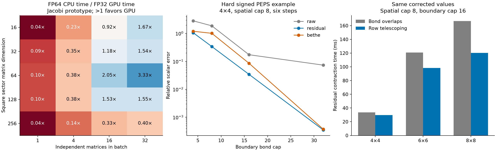

# Apple Silicon and PEPS contraction: research and experiments

Follow-up: the [priority implementation pass](apple-priority-implementation.md) has now integrated row telescoping and tested finite environment-guided compression and blocked Metal Jacobi. The prospective priority list below records the original research plan.

Research date: **13 October 2026**. Hardware: Apple M4 Pro, 24 GiB unified memory. This report combines a targeted primary-source literature review, an audit of existing project experiments, and new executable prototypes. It distinguishes measured results from proposed algorithms. It does not claim that every possible GPU or PEPS algorithm has been exhausted.

The most promising direction is **better environment-aware compression, combined with an executor that batches independent numerical work**. Moving each small contraction or SVD to Metal is insufficient. Ordinary BP is also not an adequate replacement for our signed PEPS contraction on the evidence available.

The new code is experimental and is not selected by the production solvers. Existing FP64 defaults and scientific conventions remain intact. The regression suite passed **228 tests, with one skip and four passing subtests**, including explicit Metal tests.

## Findings that change the priorities

1. **A useful exact rearrangement exists inside the current residual method.** Telescoping within each row removes redundant scalar contractions. Six benchmarks give 1.14–1.41× faster residual contraction with identical corrected values. This is a small whole-run gain where spatial evolution dominates.
2. **Jacobi is a batching opportunity, not a bond-dimension rule.** We tested the existing shader, a direct square-matrix variant, threadgroup storage, different thread counts, convergence stopping, and numerical deflation. Some batches outperform CPU SVD. Single matrices generally lose; a single workgroup is particularly poor at dimension 256. The numerical nullspace still prevents treating the experimental factors as full canonical isometries.
3. **Low-rank algorithms can matter more than the device.** On one synthetic batch of four 1024-square matrices, rank-32 CPU randomized SVD takes 19.86 ms versus 390.92 ms for full SVD; hybrid range finding with an FP64 core takes 15.33 ms. These are different approximation algorithms, not a 25× GPU acceleration of the same SVD.
4. **Matrix-product BP is relevant, but the first inexpensive component does not beat our residual correction consistently.** We implemented a finite, signed two-sided Bethe estimator and tested 96 settings on 24 evolved PEPS snapshots. It often improves dramatically over an uncorrected boundary sweep, but costs more than the current residual method and fails on some insufficiently resolved cases.
5. **Environment-guided contraction trees deserve a serious next implementation.** They can change which directions survive compression, whereas our correction estimates the effect of directions already discarded. Recent finite-network methods are a closer fit than directly importing infinite-PEPS CTMRG.



The Jacobi panel compares FP64 CPU with FP32 GPU arithmetic and does not certify a valid full SVD. The PEPS panel uses exact contraction of the same spatially truncated PEPS as its reference. Neither panel measures a complete GPU solver speedup.

## What is special about this problem

Our closed PEPS represents a **signed single-layer Pauli scalar**, not automatically a positive PEPS norm. Even the unsigned elementary-transfer calculation can acquire signed local factors after SVD gauge changes. Taking absolute values of those tensors changes the problem. Positivity or positive-semidefinite-message guarantees for double-layer norm networks therefore cannot be assumed here.

The Pauli-Lindblad channel is diagonal at each native noise insertion. Weight-two generators create pair factors, including factors crossing disjoint Heisenberg pairs. Products of these factors form a graphical model; they do not make the entire noisy layer one tensor product over those pairs. This is consistent with the sparse correlated-noise model of [van den Berg, Minev, Kandala and Temme](https://arxiv.org/abs/2201.09866).

A useful algebraic observation for our implementation is that all diagonal generators on one edge combine into one 4-by-4 table of Pauli-label weights. Its matrix rank is at most four. This can avoid introducing a separate auxiliary bond for every generator. The experimental `cnot_noise_mpo.py` already combines edge tables and guards the graph-frontier dimension; adding another generic noise MPO is not a new optimization. A narrow graph frontier is useful, but arbitrary long-range edges can make its exact bond grow exponentially.

Internal Z2×Z2 charge conservation reduces compatible numerical blocks. It does not remove spatial loops, establish correlation decay, imply spatial C4v symmetry, or guarantee a positive network. Transported charge frames, CNOT/noise ordering, and the restoration of the standard frame must remain explicit.

The unsigned method uses the absolute values of **elementary transfers**. It must not be replaced by the absolute value of a fused signed transfer. Ratio and Q± estimates remain sensitive to small denominators and cancellation.

There are also two distinct error sources:

- **Spatial PEPS evolution truncation:** changes the PEPS being represented.
- **Boundary contraction truncation:** approximates the scalar of that fixed PEPS.

The current PEPS residual method corrects the second. A perfect contraction of a low-cap PEPS does not establish circuit accuracy. The new benchmark references deliberately isolate boundary error.

## GPU and hybrid experiments

All reported microbenchmarks use warmed medians, one BLAS thread, and explicit GPU completion. Packing/conversion and returning factors to CPU are included. They do not include first-use shader compilation. CPU worker-pool experiments separately test parallel decompositions. No other numerical benchmark ran concurrently.

### Existing Jacobi audit and new kernel

`peps_gpu_decomp.py` already contained Householder QR and one-sided Jacobi kernels. The new work builds on this rather than claiming to introduce GPU SVD for the first time.

The original benchmark compares QR-plus-Jacobi and direct Jacobi, 8/16/32 sweeps, dimensions 16/32/64/128, and batches 1/4/16. Its absent captured sizes use explicitly labelled random matrices. The later `adaptive_real` experiment fills missing sizes by capturing additional MPS runs at the corresponding caps; all five final sizes 16–256 use actual MPS sector matrices. Each batch repeats up to eight captured matrices. Such a batch is a throughput experiment: those matrices are not necessarily simultaneously available during a sweep.

The audit exposed an important numerical failure: a rank-deficient 16-square case reconstructed well with direct Jacobi, yet the full U orthogonality error was of order 10^19. Squaring tiny columns in FP32 underflowed during normalization. The QR-plus-Jacobi route also showed a roughly 1.9×10^-5 reconstruction error on that case. Increasing the sweep count did not repair this.

`apple_jacobi_experiment.py` adds scaled column norms, threadgroup storage for small matrices, dimension-dependent layout, an early exit after a sweep with no accepted rotations, and optional deflation below 10^-7 times the input Frobenius norm. It records a convergence flag. With deflation, that flag concerns the active columns, not an accurate orthogonal nullspace.

Zero columns now return zero vectors rather than enormous vectors. Nearly null columns can still be mutually nonorthogonal. Consequently this is an **experimental factorization of the active subspace**, not a production replacement for a full canonicalization SVD. A consumer must explicitly select the supported subspace and account for discarded error, or complete the nullspace/use CPU fallback. Full-U orthogonality metrics are retained in the raw data rather than hidden.

Batched Jacobi research supports pursuing a **blocked** design for larger cores: small local eigensolvers, matrix-multiplication updates, convergence masking, and shape-specific kernels. Our one-workgroup prototype is not that algorithm. The recent [Abdelfattah–Fasi paper](https://arxiv.org/html/2601.17979v2) benchmarks NVIDIA and AMD systems; its speedups are not Apple measurements. Likewise, [Boukaram et al.](https://arxiv.org/abs/1707.05141) emphasize batching and matching kernels to the memory hierarchy.

Two Apple-specific findings narrow the options. [NextLA's 2025 paper](https://arxiv.org/html/2508.06339v1) demonstrates portable singular-value computation on Metal, but leaves singular vectors to future work, so it is not a drop-in truncation SVD. The [metal-linalg repository](https://github.com/iandriver/metal-linalg) reports small batched Jacobi/Householder kernels, with its displayed performance measured on an M5 Pro at batch 16,384 and resident GPU data. That is useful source material, not evidence of a universal D≤256 crossover. Its CPU fallback is also part of its design. We have not installed or independently benchmarked that package.

### Captured-matrix batching and CPU/GPU scheduling

Final square-matrix timings, including packing and host return:

| Sector dimension / batch | CPU FP64, serial | CPU FP32, serial | Best tested adaptive Metal variant |
|---|---:|---:|---:|
| 32 / 16 | 0.620 ms | 0.453 ms | 0.526 ms |
| 64 / 16 | 2.516 ms | 1.477 ms | 1.229 ms |
| 64 / 32 | 5.192 ms | 3.007 ms | 1.557 ms |
| 128 / 16 | 13.322 ms | 7.937 ms | 8.719 ms |
| 256 / 16 | 53.599 ms | 36.995 ms | 160.862 ms |

These are actual captured MPS matrices. The apparent gain at 128 against FP64 disappears against serial FP32 SVD, and the experimental GPU output has the nullspace limitation described above. GPU arithmetic is not providing FP64-quality factors.

A separate batch-32 scheduling experiment uses persistent CPU pools of 1/2/4/8 workers and overlaps four CPU workers with a GPU subset. It uses a fixed 128-thread kernel configuration, so GPU times need not equal the best-tuned variant above. All CPU workers use a single BLAS thread.

| Dimension | Best CPU FP64 pool | Best CPU FP32 pool | All GPU | Best CPU/GPU split |
|---|---:|---:|---:|---:|
| 32 | 1.370 ms | 0.997 ms | 0.833 ms | 0.971 ms |
| 64 | 5.202 ms | 3.132 ms | 2.114 ms | 2.224 ms |
| 128 | 27.482 ms | 16.648 ms | 29.640 ms | 16.696 ms |
| 256 | 105.091 ms | 71.297 ms | 241.939 ms | 122.545 ms |

The mixed split uses FP64 CPU and FP32 GPU work. At dimension 128 it improves throughput relative to either all-FP64 CPU or this all-GPU configuration, but is essentially tied with the FP32 CPU pool. More CPU workers did not consistently accelerate these sizes on the installed stack. This is a measured limitation, not an assertion that CPU batching cannot scale elsewhere. Real scheduling must also account for how many decompositions are ready at once and whether their required accuracy permits FP32.

### Mixed-precision randomized SVD

`benchmarks/explore_hybrid_lowrank.py` compares full FP64 SVD, CPU randomized SVD, GPU range finding with FP64 CPU QR/core factorization, and a GPU-computed FP32 projected core. Sketch oversampling is eight, with zero, one or two normalized power iterations. All operations and synchronization are timed.

Selected batch-of-four, rank-32, one-power-iteration results:

| Input | Full CPU SVD | CPU randomized | GPU range / FP64 core | GPU range / FP32 core |
|---|---:|---:|---:|---:|
| Captured 256×256 sectors | 12.77 ms | 3.55 ms | 4.17 ms | 3.97 ms |
| Synthetic 512×512, declining spectrum | 85.67 ms | 7.47 ms | 7.08 ms | 7.17 ms |
| Synthetic 1024×1024, declining spectrum | 390.92 ms | 19.86 ms | 15.33 ms | 14.61 ms |

The last row has a truncation residual about 3.7% above the optimal rank-32 residual, for both CPU and hybrid randomized variants. These synthetic matrices illustrate a regime; they do not describe current PEPS sector distributions.

Precision matters on the captured matrices. At rank 64, CPU randomized SVD has maximum relative residual 2.52×10^-12, the hybrid with FP64 core 4.68×10^-10, and the FP32 core 1.66×10^-7. An FP64 small SVD cannot restore information already lost in the range-finding products. Thus “mixed precision plus refinement” needs an actual error test, not just double-precision output arrays.

Our production code already has randomized SVD. Earlier full-run profiles did not use it when the requested rank plus oversampling approached the whole sector dimension. Forcing the lower ranks used in this experiment would change truncation. Rank-adaptive policies should be compared at equal observable accuracy, preserving rank competition across charge sectors. [Kohn et al.](https://arxiv.org/abs/1710.01463) provide relevant tensor-network precedent.

### GEMM-based polar canonicalization

`benchmarks/explore_gpu_polar.py` tests a simple compiled Newton–Schulz iteration, not the full stabilized TPU algorithm. It produces Q and H≈QᵀA; H is generally not triangular. This is a possible canonicalization factorization, not an SVD or a triangular QR replacement in an arbitrary API.

For four synthetic 512×256 matrices with condition number 10, 24 iterations take 5.12 ms versus 11.44 ms for CPU QR. Reconstruction error is about 9.1×10^-7 and Q orthogonality error 5.5×10^-6. For condition number 10^6, stopping at 24 iterations leaves orthogonality error around 9.2; 40 iterations reduce it to 4.9×10^-5 at 7.51 ms. A small-looking reconstruction error alone would miss a poor canonical gauge.

This makes polar methods worth further conditioning-aware work on large resident batches, but inappropriate as an unconditional exact-gauge operation. The motivation comes from [Ganahl et al.'s TPU DMRG work](https://arxiv.org/abs/2204.05693); those hardware and matrix-size results are not a performance forecast for this Mac.

## PEPS message passing and contraction experiments

### Ordinary BP is not the recommended replacement

The existing workspace report `peps_bp_pilot_report.md` already tested signed region BP on small PEPS. In a four-by-four, two-step case, a converged 2×2-region run could give the wrong sign for the attenuation ratio. Other converged seeds and a 3×3 partition remained inaccurate. Those older tests used noise after Heisenberg gates, so their numbers are not presented as new after-CNOT benchmarks. Their relevant lesson is that fixed-point convergence is not a contraction-error certificate.

The recent [generalized-BP paper](https://arxiv.org/html/2604.24760v1) strengthens this caution: the authors report convergence problems when negative/complex entries are substantial, and the generalized update need not preserve PSD messages. Positive Boltzmann weights in a frustrated classical model are not equivalent to our signed Pauli factors. This does not rule out every message-passing approach; it changes which one to prioritize.

### Finite boundary-MPS Bethe estimator

The [Matrix Product Belief Propagation preprint](https://arxiv.org/abs/2609.05598), submitted September 2026, develops a Bethe estimator with errors quadratic in small boundary-message errors, including finite and non-Hermitian networks. Full MP-BP additionally imposes stationarity with respect to the environment data. Our prototype evaluates the finite estimator using ordinary forward/backward compressed boundaries; it does **not** implement the full stationary MP-BP solver.

Writing A_y for the overlap of row y with its two incoming boundaries, and B_y for the overlap of the two messages across cut y, the tested estimator is

Z_B = (product_y A_y) / (product_cuts B_y).

Each message's arbitrary nonzero normalization cancels. We track signs and sum logarithms of magnitudes. A zero/nonfinite local overlap is returned as an invalid estimate, not regularized into a plausible number. The small-error expansion does not guarantee accuracy for poor messages or near-zero denominators.

We compared raw boundary contraction, existing additive residual correction, and this estimator on 24 fixed 4×4 PEPS: signed/unsigned, spatial caps 4/8, depths 2/4/6, and noise scales including zero. There are 96 boundary-cap settings. Both noisy cases and noiseless controls use the same after-CNOT implementation, including graph-wide weight-two noise at nonzero scale.

Selected relative errors against exact contraction of the fixed PEPS:

| Spatial cap / steps / scale / boundary cap | Raw | Residual | Bethe |
|---|---:|---:|---:|
| 4 / 2 / 0 / 4, signed | 54.88% | 0.000956% | 0.1817% |
| 4 / 4 / 0 / 4, signed | 103.28% | 0.2728% | 2.988% |
| 8 / 2 / 0 / 4, signed | 8.324% | 0.4388% | 0.4129% |
| 8 / 6 / 0 / 4, signed | 282.67% | 105.68% | 119.68% |

At spatial cap 8, the worst relative error across the tested networks at boundary cap 32 was 7.35% raw, 0.0350% residual and 0.0374% Bethe. Two of the 96 Bethe settings were explicitly invalid because of zero overlaps. This must not be silently excluded when comparing success rates.

Bethe evaluation was roughly 1.36–1.51 times the residual-contraction time by median within each cap group. It currently constructs its own boundaries; sharing suitable message work could reduce that overhead. Increasing boundary resolution is still necessary for hard cases. We should not add the Bethe adjustment and the existing additive residual blindly, since they address overlapping truncation errors.

### Derived ratio and Q checks

The archive also contains 48 derived curve settings, using the existing denominator threshold and nonnegative-mass policy. These are formed from the already measured signed and unsigned contractions, not from a different evolution.

For spatial cap 8, six steps and scale 1, exact contraction of the fixed PEPS gives ratio −0.09052364. At boundary cap 4, raw, residual and Bethe ratios are respectively +0.04963, +1.59528 and +0.46007: all are wrong in sign. At cap 32 they become −0.09770036, −0.09049194 and −0.09048982. Thus a correction cannot compensate for arbitrarily poor boundary resolution.

In the same example Q± are close to 1.069×10^-9 and are considerably less sensitive to the signed contraction error. Accurate-looking Q values alone therefore do not certify a good signed attenuation ratio. All reference quantities here still inherit spatial PEPS truncation; cap-4 and cap-8 evolved states can differ substantially.

### Row telescoping: a directly useful simplification

Within a row the backward environment is fixed. Let b_0,…,b_m be the scalar overlaps before the first and after successive bond truncations. The existing correction is

sum_j (b_{j-1} − b_j) = b_0 − b_m.

`row_residual_contract` therefore performs the same tensor updates and computes just two overlaps per compressed row. It returns row-level records, so individual bond diagnostics are deliberately not available. This is an algebraic identity, not a BP approximation.

The six repeated timing comparisons use 4×4, 6×6 and 8×8 after-CNOT PEPS, spatial cap 8 and boundary caps 8/16. The speedups range from 1.14× to 1.41×, or about 12–29% less residual-stage time. On the 8×8 cap-16 case: 166.6 ms becomes 120.4 ms; the corrected scalar is identical in the recorded results. Process peak RSS during this benchmark series was about 300 MiB; it is a process-wide high-water mark, not an isolated allocation measurement for either method.

Spatial evolution in that case took 2.82 seconds. Adding its cost gives only about 1.6% whole-run improvement from this contraction change. This illustrates why the next performance work must also address evolution contractions and decompositions.

### The strongest next algorithmic experiment

[CT-bMPS, an October 2026 preprint](https://arxiv.org/html/2610.06574v1), represents both sides of contraction-tree edges by boundary MPS and uses the opposite message to guide compression through a reduced transition matrix. It includes signed-network tests; strongly cancelling instances can still retain order-one error. Converged sweeps are explicitly not an accuracy guarantee. It is a recent research proposal, not a validated backend in this project.

Our proposed adaptation is to start with the existing finite boundary geometry, use the backward guide to choose retained directions, and only then consider arbitrary contraction trees. Keep the actual target-minus-compressed residual for every changed truncation. Compare raw, additive-corrected, and Bethe estimates separately at equal time and memory. If the finite-strip pilot works, extend to trees selected by measured contraction/write cost and geometry.

An approximate message can also be used as a **residual guide**. For truncation residual r_j and exact/approximate suffix E_j and E~_j, the remaining scalar error is sum_j ⟨E_j−E~_j, r_j⟩. This explains why a relatively inexpensive message might be useful without being accurate enough as a stand-alone contraction. It is not a computable error bound unless the guide error itself is bounded. Raising guide caps and comparing independent directions are diagnostics, not proofs.

## Implementation order and acceptance criteria

1. **Integrate row telescoping behind a diagnostic-granularity option.** Keep bond-level records where requested. Validate full ratio/Q curves and both CPU/GPU boundary contexts before changing the default implementation.
2. **Prototype environment-aware finite-strip compression.** This is the closest extension of our existing backward guides, and avoids implementing a general tree engine before its truncation rule has demonstrated value.
3. **Measure rank fraction and ready-batch size in real evolution.** Use per-sector dimensions and dependencies, not the nominal global bond cap. Compare persistent CPU pools before selecting GPU work.
4. **Develop blocked Jacobi or QR-based controlled expansion for the remaining expensive sectors.** Retain a robust FP64 fallback, explicit deflation, and support/nullspace tests. Full-run signed O, unsigned U, ratio/Q and residual accuracy decide promotion.
5. **Try MP-BP stationary updates, contraction-tree messages and selected loop clusters.** Prioritize the regimes where the finite-strip test leaves substantial boundary error. Treat each as a separate approximation whose error and cost must be measured.

The broader candidate map and source-by-source applicability analysis are in [the companion literature review](peps-message-passing-literature.md). It includes approaches that are promising but not implemented, as well as options deprioritized by the evidence.

## Reproduction and artifacts

The [archived measurements and source hashes](apple-silicon/exploration-20261013.json) contain the reported cases. Local detailed files are under `results/exploration_20261013`. Timings can vary with thermal state, thread scheduling and library versions; modest single-run differences should not drive a production policy.

From the repository root, prefix commands with:

```sh
export NUMBA_CACHE_DIR=/tmp/pauli_cnot_numba
export OPENBLAS_NUM_THREADS=1 VECLIB_MAXIMUM_THREADS=1 NUMBA_NUM_THREADS=1
export MPLCONFIGDIR=/tmp/pauli_cnot_mpl PYTHONPATH=cnot_zne
```

Then run the desired experiments:

```sh
.venv312/bin/python benchmarks/explore_apple_svd.py --sizes 16 32 64 128
.venv312/bin/python benchmarks/explore_adaptive_jacobi.py --deflation-tol 1e-7 --output results/exploration_20261013/adaptive_real.json
.venv312/bin/python benchmarks/explore_decomposition_scheduling.py
.venv312/bin/python benchmarks/explore_hybrid_lowrank.py
.venv312/bin/python benchmarks/explore_gpu_polar.py
.venv312/bin/python benchmarks/explore_peps_estimators.py
.venv312/bin/python benchmarks/explore_peps_estimators.py --spatial-cap 8 --steps 2 6 --scales 0 .25 1 --caps 4 8 16 32 --output results/exploration_20261013/estimators_cap8.json
.venv312/bin/python benchmarks/explore_row_residual.py
.venv312/bin/python benchmarks/summarize_exploration.py
```

GPU commands require Metal access. Run numerical benchmarks sequentially. The scripts report individual kernels/stages and approximation errors; none establishes a production GPU crossover by itself.
