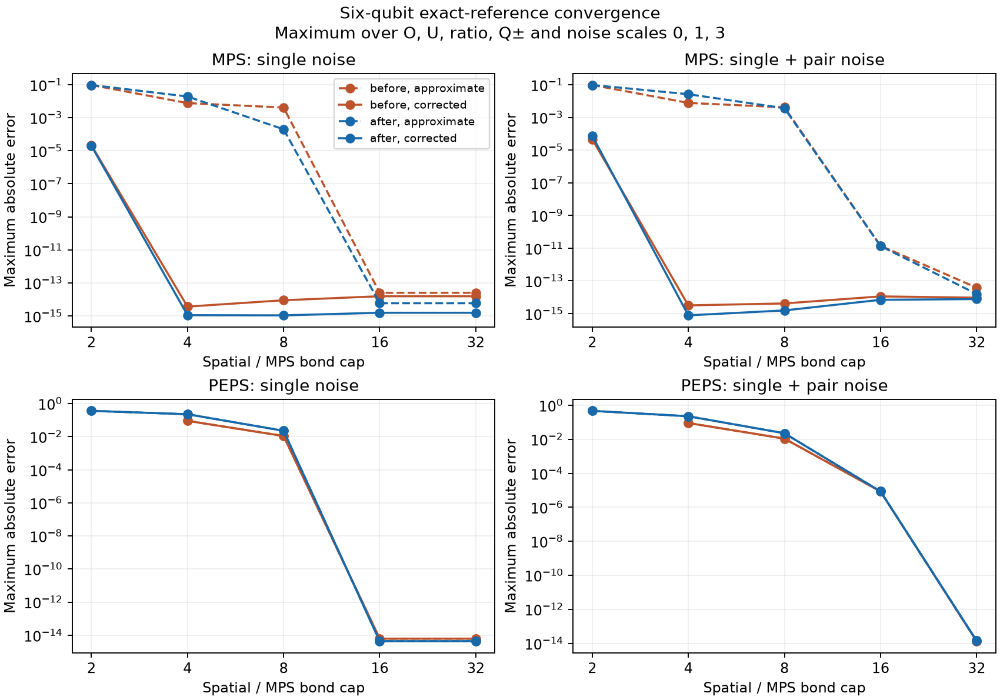

# CNOT-noise convergence and profiling

Date: 2026-10-13. Baseline: commit `6664cc5`; optimized: current local fusion/scheduling/caching/routing changes. These are exploratory local measurements, not a guarantee for larger circuits.

## Exact-reference comparisons

Both versions use the same after-CNOT noise model. The independent dense elementary-circuit calculation supplies signed O and unsigned U; ratios and Q± are formed separately using each method’s own zero-noise denominator. We compare absolute errors in all five quantities at noise scales 0, 1, 3. Near-zero approximate denominators are marked undefined and cannot pass an accuracy threshold.

Settings: six qubits; MPS chain with two steps, guide cap 32; PEPS 2×3 with one step, boundary cap 8 and environment cap 32. Both use phi=0.23, observable Z0 Z1, single rates (0.003, 0.006, 0.009), and either zero pair noise or rate 0.0005 for each of nine products on every lattice edge. Spatial caps: 2, 4, 8, 16, 32. Each evaluation was timed twice after an initial warm-up; reported curve time sums the median times for six signed/unsigned evaluations. CPU numerical libraries use one thread. Timing differences of a few percent are not decisive.

The table uses the smallest tested cap for which **all five quantities have error below 1e-8** across the three scales, with residual correction.

| Model | Cap (both versions) | Before curve time | After curve time | Speedup |
|---|---:|---:|---:|---:|
| MPS, single | 4 | 0.583 s | 0.100 s | 5.84× |
| MPS, single + pair | 4 | 0.821 s | 0.417 s | 1.97× |
| PEPS, single | 16 | 0.158 s | 0.090 s | 1.75× |
| PEPS, single + pair | 32 | 0.397 s | 0.371 s | 1.07× |

MPS correction reaches near-machine precision from cap 4 in these examples. Low-cap PEPS answers are not monotonic and its boundary correction does not remove spatial evolution truncation. With correlated noise, PEPS cap 16 gives maximum Q+ error about 8.6e-6; cap 32 reduces all measured errors below 1.5e-14. No claim is made that these caps suffice at larger sizes or depths.

Dashed lines show uncorrected estimates; solid lines show residual-corrected estimates. Missing low-cap points have an undefined normalized quantity. Values near 1e-14–1e-15 are roundoff, not meaningful accuracy rankings.

## Residual-cap checks

At MPS cap 2, correlated noise and scale 3, increasing the guide cap from 4 to
64 reduces the signed residual-corrected error from 3.4e-3 to 2.8e-17 and the
unsigned error from 5.4e-3 to 2.8e-17. The signed error is not monotonic between
guide caps 16 and 32. A small residual is not itself an accuracy certificate;
the guide cap must be checked independently.

For this shallow 2×3 PEPS case, the boundary/environment sweep (boundary caps
1,2,4,8; environment caps 2,8,32; spatial cap 32) already gives machine-precision
answers at the smallest settings. It therefore does not stress-test boundary
residual convergence in larger/deeper networks. The spatial-cap sweep above is
the informative convergence check here.

## Correlated-noise PEPS profile

A warmed 4×4, one-step, cap-4 quimb evaluation was profiled three times. Of 3.54 seconds under cProfile, 3.36 seconds was in CNOT evolution and 3.09 seconds in generic two-site simple updates. Block-sparse fusion/unfusion, contractions, gauge scaling, and dispatch dominate. The block-sparse QR/SVD wrappers together account for about 0.19 seconds; compilation and fusion are minor contributors. Profile times include substantial instrumentation overhead and must not be compared directly with unprofiled timings.

The next implementation target is a specialized diagonal two-site noise update: scale the relevant Pauli-index blocks directly and reuse the existing parity-aware split, avoiding generic rank-four gate contraction and repeated tensor/index setup where possible. This still requires spatial compression for correlated noise; it cannot generally become an on-site update.

## Larger Metal comparison

Both workloads use correlated rate 0.0001, spatial/boundary caps 8, environment cap 16, residual correction, and observable sites nx+1,nx+2. Three timed runs follow a warm-up. CPU is batched-cpu/BLAS. Metal gates/BLAS isolates gate acceleration; Metal gates/Metal-Jacobi also changes boundary contraction. These compare backends at fixed caps, not accuracy against an exact large-system solution.

| Lattice / steps | Gate / boundary backend | Median seconds | Absolute difference from CPU |
|---|---|---:|---:|
| 4×4 / 2 | batched-cpu / blas | 1.856 | 0.00e+00 |
| 4×4 / 2 | metal / blas | 2.504 | 3.43e-07 |
| 4×4 / 2 | metal / metal-jacobi | 2.429 | 3.50e-07 |
| 6×6 / 1 | batched-cpu / blas | 0.794 | 0.00e+00 |
| 6×6 / 1 | metal / blas | 1.232 | 1.12e-08 |
| 6×6 / 1 | metal / metal-jacobi | 1.450 | 1.71e-08 |

Metal is slower for both workloads at these caps. CPU remains the practical default here; larger bond dimensions may change the tradeoff. GPU/CPU differences also need comparison with the scientific accuracy target.

## Reproduction and data

- `benchmarks/benchmark_cnot_convergence.py --output results/cnot_convergence_after.json`; use `--module-dir` with the baseline modules for the before run. `--resume` skips completed cases in that output file; only resume with unchanged settings/code.
- `benchmarks/summarize_cnot_convergence.py` creates the summary and plot.
- `benchmarks/benchmark_cnot_residual_caps.py` separately sweeps guide/environment caps.
- `benchmarks/profile_cnot_peps.py` creates the cProfile report.
- `benchmarks/benchmark_cnot_metal.py` requires a working local Metal device.

Run all scripts with the project Python environment and `OPENBLAS_NUM_THREADS=1 VECLIB_MAXIMUM_THREADS=1 NUMBA_NUM_THREADS=1`. Original per-evaluation values/timings are in local `results/cnot_convergence_before.json` and `results/cnot_convergence_after.json`. Compact convergence, backend, residual-cap data and the text profile accompany this report.
